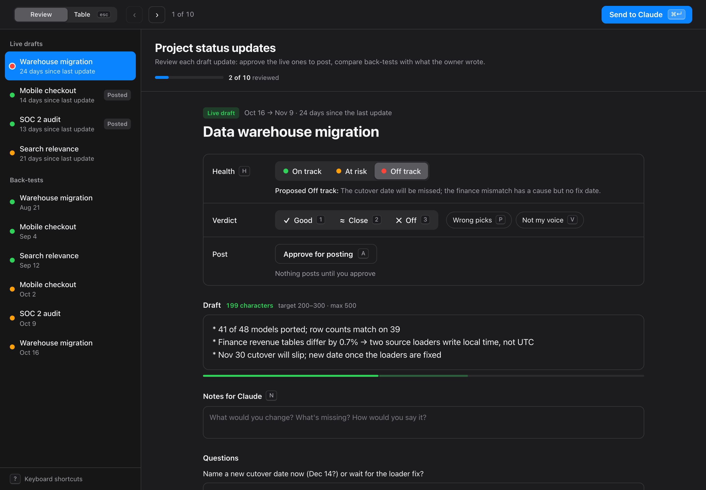
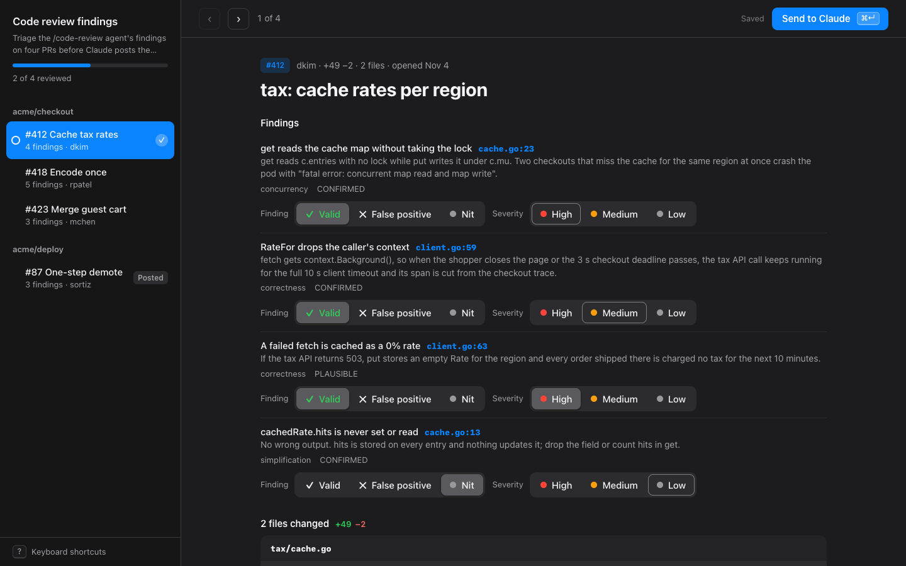
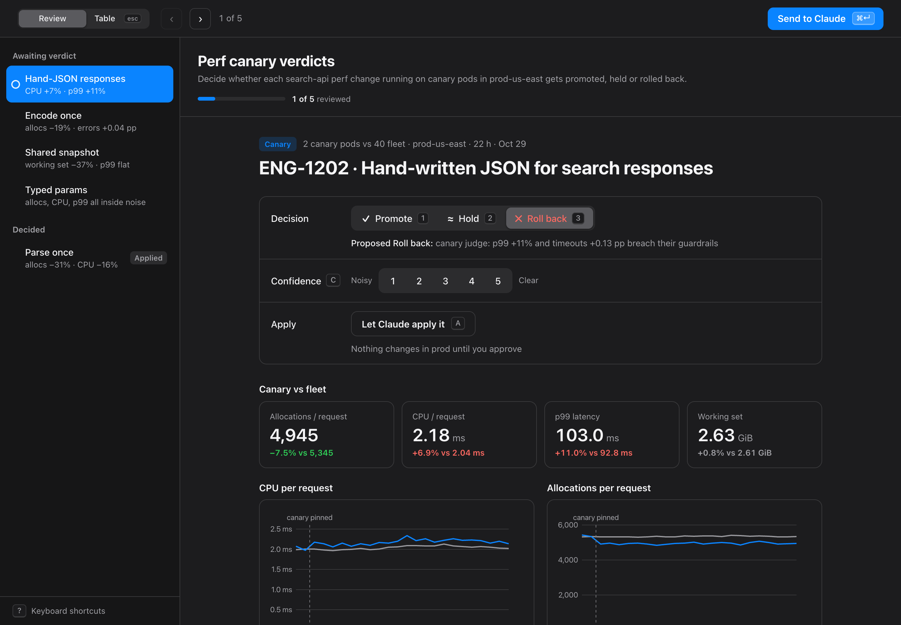

# evalkit

A keyboard-first review page for agent output, driven by a YAML schema. An agent writes a suite, the human reviews it in the browser and presses ⌘↵ whenever they like, and the agent gets back only what changed. Every suite also opens as a table: one row per item, a column per judged or measured value, with histograms and Δ-from-baseline in the headers, so a judge loop's hundreds of rows can be explored and spot-checked. One static Go binary with the UI embedded (Preact + htm, no build step); two dependencies.

<table>
  <tr>
    <td width="50%" valign="top">
      <a href="docs/screenshots/status-updates.png"></a>
      <br><sub><b><a href="demos/01-status-updates">Status updates</a></b>: edit the draft against a length target, pick a verdict and flags, answer the agent's questions.</sub>
    </td>
    <td width="50%" valign="top">
      <a href="docs/screenshots/code-review.png"></a>
      <br><sub><b><a href="demos/02-code-review">Code review</a></b>: triage each finding and accept or change the proposed severity before anything posts.</sub>
    </td>
  </tr>
  <tr>
    <td width="50%" valign="top">
      <a href="docs/screenshots/perf-canary.png"></a>
      <br><sub><b><a href="demos/03-perf-canary">Perf canary</a></b>: metric tiles and canary-versus-fleet charts behind a promote, hold or roll back verdict.</sub>
    </td>
    <td width="50%" valign="top">
      <a href="docs/screenshots/extraction.png"></a>
      <br><sub><b><a href="demos/05-extraction">Invoice extraction</a></b>: mark a field wrong, type the fix, and precision and recall update as you go.</sub>
    </td>
  </tr>
  <tr>
    <td colspan="2" valign="top">
      <a href="docs/screenshots/judge-round.png"></a>
      <br><sub><b><a href="demos/08-judge-round">LLM judge round</a></b>: the table view. Every row a judge graded, with histograms and the change from the baseline in each header; click a bar to filter, open a flagged row to override the judge.</sub>
    </td>
  </tr>
</table>

```sh
go install github.com/jryio/evalkit/cmd/evalkit@latest   # or: make install, from a checkout

evalkit init           # ./suite.yaml, a starter to edit
evalkit serve          # review page at http://127.0.0.1:8790, opens the browser
evalkit wait           # (the agent) blocks until the human sends, prints what changed
evalkit skill --install   # teach Claude Code the loop: ~/.claude/skills/evalkit/SKILL.md
```

`evalkit help` lists every command; `evalkit help <command>` shows flags and examples. `make release` builds static binaries for macOS, Linux and Windows into `dist/`.

- **Schema:** [docs/schema.md](docs/schema.md) (also `evalkit docs`). How the demos shaped it: [docs/schema-changelog.md](docs/schema-changelog.md). Prior art: [docs/research/prior-art.md](docs/research/prior-art.md). Decisions: `adr list`.
- **Agent protocol:** [skill/SKILL.md](skill/SKILL.md).
- **Catalog:** `examples/kitchen-sink/suite.yaml` renders every artifact and question kind once.

## Demos

| # | Demo | What it exercises |
|---|---|---|
| 1 | [Project status updates](demos/01-status-updates) | Editable text with a length meter, compare against gold, tone choices with proposals, flag chips, an action gate (post), agent questions, evidence list with per-row toggles |
| 2 | [Code review findings](demos/02-code-review) | Per-row choices on findings with proposed severities, links from a finding to its diff line, diff, test results |
| 3 | [Perf canary verdicts](demos/03-perf-canary) | Metric tiles and tables with deltas, time-series charts with marks, a proposed verdict, confidence scale, apply action |
| 4 | [Response preference](demos/04-pairwise) | Prompt and two responses side by side, A/B/tie/both-bad, a per-criterion rubric (per-row scales), LLM-judge calibration |
| 5 | [Invoice extraction](demos/05-extraction) | Document beside a table of fields, per-row correct/wrong/missing, a correction box that appears only when needed, live precision and recall |
| 6 | [Agent trajectories](demos/06-trajectories) | Transcript of tool calls, pick the first wrong step, failure taxonomy, a misleading auto-grader proposal |
| 7 | [Price recommendations](demos/07-price-changes) | Per-row approve and number inputs with model proposals, metrics and a bar chart, a staging action (synthetic numbers) |
| 8 | [LLM judge round](demos/08-judge-round) | The table view: a hill-climbing round's rows appended as JSONL, judge verdicts and 0–10 scores as proposals, measured values with baselines, flagged rows, Δ columns (`python3 build.py --trickle` streams rows in live) |
| 9 | [Model sweep](demos/09-model-sweep) | Runs: twelve model × effort configurations over the same cases and reps, two ordinal dimensions, a baseline run (what ships today), cost against pass rate with a dominated configuration |
| 10 | [Weekly samples](demos/10-weekly-samples) | Runs over time: six weekly runs of fresh production tickets with no pairing, a date dimension, a dip and recovery in the pass rate, run notes |
| 11 | [Judge change](demos/11-judge-change) | Two runs of the same drafts graded by an old and a new rubric, identical `show`, different proposals, flagged verdict flips; opens in the default view |

Run one: `bin/evalkit serve demos/0N-*/suite.yaml`. Feedback lands in `feedback/` beside the suite (git-ignored).

### Coverage

Every question kind and artifact kind appears in the kitchen sink. Across the demos:

| Kind | Demos |
|---|---|
| choice, text | all |
| action | 1, 2, 3, 7 · multi 1, 6 · scale 3, 4 · toggle 1, 7 · number 7 · pick 6 |
| list | 1, 2, 3, 4 · table 1, 3, 5, 6, 7 · markdown 2–7 · json 5, 6 · metrics 3, 7 · chart 3, 7 |
| text 1 · diff 2 · tests 2 · transcript 6 · tally 5 | single-domain kinds: each matches one workflow's evidence |
| code, image | kitchen sink; `image` also carries the screenshots in the dogfood review suite |

## Layout

```
cmd/evalkit/        CLI: validate, serve, wait, summarize, done, schema
internal/suite/     load YAML, JSON Schema validation with line numbers, semantic checks
internal/feedback/  state, numbered snapshots, action results
internal/server/    HTTP API and static files
internal/summary/   diff of two snapshots, for agents
web/kit/core/       framework-free state, derivations and keyboard model (node --test)
web/kit/ui/         layout: App, Sidebar, ItemView, ItemsTable, micro charts, sheets
web/kit/controls/   one module per question kind
web/kit/renderers/  one module per artifact kind
web/styles/         tokens (light and dark) and component CSS
```

Adding a kind: write the module, register it in `web/kit/builtins.js`, add its branch to `internal/suite/suite.schema.json`, and add an item to the kitchen sink.

## Tests

`make test` runs `go vet`, `go test -race` and the Node tests. With a server running, `tests/e2e/smoke.sh <port>` opens every item and fails on render errors, and `tests/e2e/flow.sh <port>` does a keys-only review with two sends.
