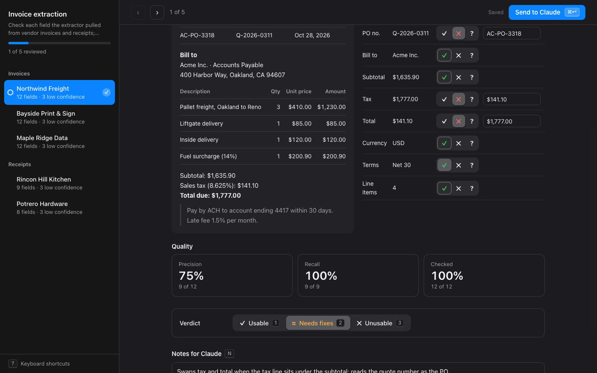
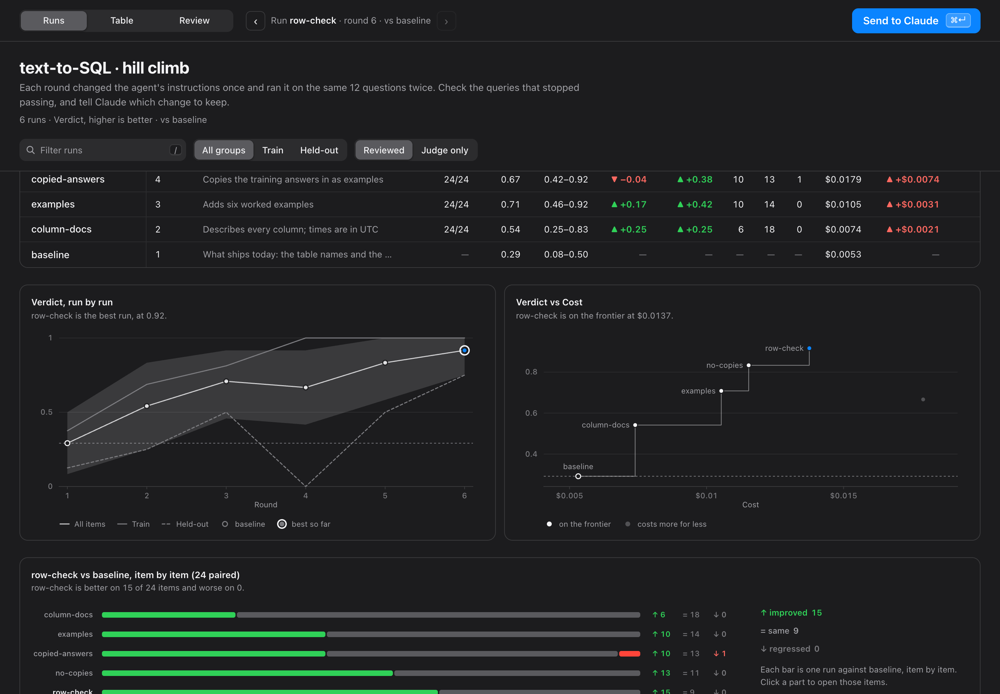

# evalkit

evalkit is a review system for building evals with your agent. You describe an eval in a short YAML file, and evalkit turns it into a review page: the work to check, the questions to answer and the scores to keep.

Use it on anything you want to get better at: writing, code, performance benchmarks, a judge's grades, or data pulled out of documents. Grade by hand, let an automated grader suggest answers for you to confirm, or combine the two.

- **Score what matters to you.** Pass or fail, a category such as tone, confidence or slop, a rating from 1 to 10, or a measurement such as CPU time, latency or error count.
- **Run the eval, too.** Give a suite a `bench` block and `evalkit run` puts every case through an agent (`claude`, `codex`, `pi` or any command), each attempt isolated in its own workspace, then through your scorers and a judge. `evalkit climb` hill-climbs a prompt or a skill against it.
- **Track every round.** Run the same eval again and again, and evalkit shows whether each score is trending up or down and which cases regressed, so you can hill-climb on the score you care about.
- **Stay on the keyboard.** Moving between items, answering and sending all have shortcuts. evalkit is a single Go binary with the page built in.

Most importantly, your feedback from every round goes back to your agent, so its next attempt starts from what you said.

<table>
  <tr>
    <td width="50%" valign="top">
      <sub><b><a href="demos/01-status-updates">Status updates</a></b>: edit a draft against a length target, pick a verdict and flags, and answer open questions.</sub><br>
      <a href="docs/screenshots/status-updates.png"></a>
    </td>
    <td width="50%" valign="top">
      <sub><b><a href="demos/02-code-review">Code review</a></b>: triage each finding, then read the change as a split diff before any comment posts.</sub><br>
      <a href="docs/screenshots/code-review.png"></a>
    </td>
  </tr>
  <tr>
    <td width="50%" valign="top">
      <sub><b><a href="demos/03-perf-canary">Perf canary</a></b>: promote, hold or roll back a change, with its metrics and charts against the fleet.</sub><br>
      <a href="docs/screenshots/perf-canary.png"></a>
    </td>
    <td width="50%" valign="top">
      <sub><b><a href="demos/05-extraction">Invoice extraction</a></b>: mark a field wrong, type the fix, and watch precision and recall update.</sub><br>
      <a href="docs/screenshots/extraction.png"></a>
    </td>
  </tr>
  <tr>
    <td width="50%" valign="top">
      <sub><b><a href="demos/08-judge-round">LLM judge round</a></b>: see every row a judge graded in one table, with a histogram and the change from the last round in each column.</sub><br>
      <a href="docs/screenshots/judge-round.png"></a>
    </td>
    <td width="50%" valign="top">
      <sub><b><a href="demos/12-hill-climb">Hill climb</a></b>: follow six rounds of prompt changes on the same questions: the score round by round, and what each round fixed or broke.</sub><br>
      <a href="docs/screenshots/hill-climb.png"></a>
    </td>
  </tr>
</table>

```sh
go install github.com/jryio/evalkit/cmd/evalkit@latest   # or: make install, from a checkout

evalkit init           # writes ./suite.yaml, a starter to edit
evalkit serve          # opens the review page at http://127.0.0.1:8790
evalkit wait           # waits for you to press Send, then prints what changed
evalkit skill --install   # teaches Claude Code the whole loop
```

`evalkit help` lists every command; `evalkit help <command>` shows flags and examples. `make release` builds static binaries for macOS, Linux and Windows into `dist/`.

- **Schema:** [docs/schema.md](docs/schema.md) (also `evalkit docs`). How the demos shaped it: [docs/schema-changelog.md](docs/schema-changelog.md). Prior art: [docs/research/prior-art.md](docs/research/prior-art.md). Decisions: `adr list`.
- **Claude Code skill:** [skill/SKILL.md](skill/SKILL.md).
- **Catalog:** `examples/kitchen-sink/suite.yaml` renders every artifact and question kind once.

## What an eval looks like

An eval is one YAML file. Each item shows something to check and asks the same questions, and `proposed` holds a suggested answer that you keep or change. Your agent can write the file for you, and `evalkit serve` turns it into the review page.

```yaml
title: Release notes drafts
description: Approve each draft, or tell Claude what to change before it goes out.
questions:
  - id: verdict
    kind: choice
    label: Verdict
    primary: true
    options:
      - { value: ship, label: Ship it, tone: positive }
      - { value: fix, label: Needs work, tone: warning }
  - { id: note, kind: text, label: Note to Claude, key: n }
items:
  - id: v2-4
    title: Release notes for version 2.4
    show:
      - kind: markdown
        label: Draft
        text: Exports now finish in half the time, and failed uploads retry on their own.
    proposed:
      verdict: { value: ship, why: Both changes are in the changelog and the wording is plain. }
```

## Demos

| # | Demo | What it exercises |
|---|---|---|
| 1 | [Project status updates](demos/01-status-updates) | Editable text with a length meter, compare against gold, tone choices with proposals, flag chips, an action gate (post), agent questions, evidence list with per-row toggles |
| 2 | [Code review findings](demos/02-code-review) | Per-row choices on findings with proposed severities, links from a finding to its diff line, diff, test results |
| 3 | [Perf canary verdicts](demos/03-perf-canary) | Metric tiles and tables with deltas, time-series charts with marks, a proposed verdict, confidence scale, apply action |
| 4 | [Response preference](demos/04-pairwise) | Prompt and two responses side by side, A/B/tie/both-bad, a per-criterion rubric (per-row scales), LLM-judge calibration |
| 5 | [Invoice extraction](demos/05-extraction) | Document beside a table of fields, per-row correct/wrong/missing, a correction box that appears only when needed, live precision and recall |
| 6 | [Agent trajectories](demos/06-trajectories) | Transcript of tool calls, pick the first wrong step, failure taxonomy, a misleading auto-grader proposal |
| 7 | [Price recommendations](demos/07-price-changes) | Per-row approve and number inputs with model proposals, metrics and a bar chart, a staging action (synthetic numbers) |
| 8 | [LLM judge round](demos/08-judge-round) | The table view: a hill-climbing round's rows appended as JSONL, judge verdicts and 0–10 scores as proposals, measured values with baselines, flagged rows, Δ columns (`python3 build.py --trickle` streams rows in live) |
| 9 | [Model sweep](demos/09-model-sweep) | Runs: twelve model × effort configurations over the same cases and reps, two ordinal dimensions, a baseline run (what ships today), cost against pass rate with a dominated configuration |
| 10 | [Weekly samples](demos/10-weekly-samples) | Runs over time: six weekly runs of fresh production tickets with no pairing, a date dimension, a dip and recovery in the pass rate, run notes |
| 11 | [Judge change](demos/11-judge-change) | Two runs of the same drafts graded by an old and a new rubric, identical `show`, different proposals, flagged verdict flips; opens in the default view |
| 12 | [Hill climb](demos/12-hill-climb) | Six sequential rounds of prompt changes on the same questions, a round dimension, train and held-out groups, a round that overfits, regressions flagged, and a split diff of each query that changed (`python3 build.py`) |

Run one: `bin/evalkit serve demos/NN-*/suite.yaml`. Feedback lands in `feedback/` beside the suite (git-ignored).

## Benchmarks

The demos above are hand-built results. The suites under [benchmarks/](benchmarks) are run by evalkit itself: each has a `bench` block, cases, and the scripts that grade it. Their `runs/` hold real runs.

```sh
benchmarks/fixtures.sh                                   # build the fixture repositories once
bin/evalkit check benchmarks/01-go-bugfix/suite.yaml     # prove the grader: a known-good agent scores 1, a do-nothing one 0
bin/evalkit run   benchmarks/01-go-bugfix/suite.yaml --run mine
bin/evalkit serve benchmarks/01-go-bugfix/suite.yaml     # review the runs
```

| # | Benchmark | Agent | What it exercises |
|---|---|---|---|
| 1 | [Go bug fixes](benchmarks/01-go-bugfix) | codex | A git workspace cloned per slot, hidden tests copied in only by the scorer, `check` with an oracle and a null agent, an effort sweep |
| 2 | [Config leak](benchmarks/02-config-leak) | claude, codex, pi | What each agent CLI sees of your own setup with isolation off, on, and under the sandbox |
| 3 | [Text-to-SQL climb](benchmarks/03-sql-climb) | codex | A hill climb on a system prompt with a model proposer, train and held-out groups, a workspace built by a `provision` command |
| 4 | [Commit messages](benchmarks/04-commit-message-judge) | pi, codex judge | No workspace, a prompt template, a scripted format check beside a judge model, `grade --judge` |
| 5 | [Cross-repository rename](benchmarks/05-multi-repo-rename) | codex, claude | Two repositories in one slot, a check that runs one's output through the other, an agent sweep |
| 6 | [Word frequency](benchmarks/06-wordfreq-perf) | none | Plain programs timed: a column as the score, lower is better, three reps, `setup` and `reset: never` |
| 7 | [Sandbox fence](benchmarks/07-sandbox-fence) | none | Scripted agents that try to get out, with the sandbox off and on |
| 8 | [JavaScript fixes](benchmarks/08-node-deps-keep) | codex | Dependencies installed once per slot with `setup` and kept across resets with `keep`, two reps |
| 9 | [Pinned commits](benchmarks/09-pinned-commits) | codex | Each case at its own commit, later commits out of reach |
| 10 | [Document Q&A](benchmarks/10-docs-qa) | claude, pi, codex judge | A copied (non-git) workspace, `reset: run`, a judge against a reference answer |
| 11 | [CSV clean-up](benchmarks/11-csv-cleanup) | pi, codex | An output file compared with a reference, a spending limit, retries |
| 12 | [Shell filters](benchmarks/12-shell-golf) | codex | An empty workspace, hidden inputs, a measured column beside the verdict, two reps |
| 13 | [Failure handling](benchmarks/13-flaky-harness) | none | Crashes, hangs and a broken scorer: error classes, retries, resume |
| 14 | [Spam threshold climb](benchmarks/14-threshold-climb) | none | A hill climb with a scripted proposer: a round kept, a round reverted |
| 15 | [Changelog skill climb](benchmarks/15-skill-climb) | claude | A Claude Code skill overlaid into the workspace, `require_skills`, a hill climb on the skill |

The real-agent runs here use the cheapest model of each CLI: they test the harness, not the models.

### Coverage

Every question kind and artifact kind appears in the kitchen sink. Across the demos:

| Kind | Demos |
|---|---|
| choice, text | all |
| action | 1, 2, 3, 7 · multi 1, 6 · scale 3, 4 · toggle 1, 7 · number 7 · pick 6 |
| list | 1, 2, 3, 4 · table 1, 3, 5, 6, 7 · markdown 2–7 · json 5, 6 · metrics 3, 7 · chart 3, 7 |
| text 1 · diff 2 · tests 2 · transcript 6 · tally 5 | single-domain kinds: each matches one workflow's evidence |
| code, compare | 12 · kitchen sink |
| image | kitchen sink; it also carries the screenshots in the dogfood review suite |

## Layout

```
cmd/evalkit/        CLI: validate, serve, wait, summarize, done, schema; run, check, grade, climb, stats
internal/bench/     the benchmark engine: attempts, stages, judge, climb
internal/workspace/ slots: shared clones or copies, reset in place
internal/agent/     adapters over the claude, codex and pi CLIs
internal/stats/     run scores, as the page computes them
internal/proc/      child processes in their own group, killed whole
internal/suite/     load YAML, JSON Schema validation with line numbers, semantic checks
internal/feedback/  state, numbered snapshots, action results
internal/server/    HTTP API and static files
internal/summary/   diff of two snapshots, for agents
web/kit/core/       framework-free state, derivations, run statistics and keyboard model (node --test)
web/kit/ui/         layout: App, Sidebar, ItemView, ItemsTable, RunsView and its charts, micro charts, sheets
web/kit/controls/   one module per question kind
web/kit/renderers/  one module per artifact kind
web/styles/         tokens (light and dark) and component CSS
web/vendor/         Preact, htm, marked, Prism, uPlot, Observable Plot and @pierre/diffs (scripts/vendor-*.sh)
```

Adding a kind: write the module, register it in `web/kit/builtins.js`, add its branch to `internal/suite/suite.schema.json`, and add an item to the kitchen sink.

## Tests

`make test` runs `go vet`, `go test -race` and the Node tests. With a server running, `tests/e2e/smoke.sh <port>` opens every item and fails on render errors, and `tests/e2e/flow.sh <port>` does a keys-only review with two sends.
