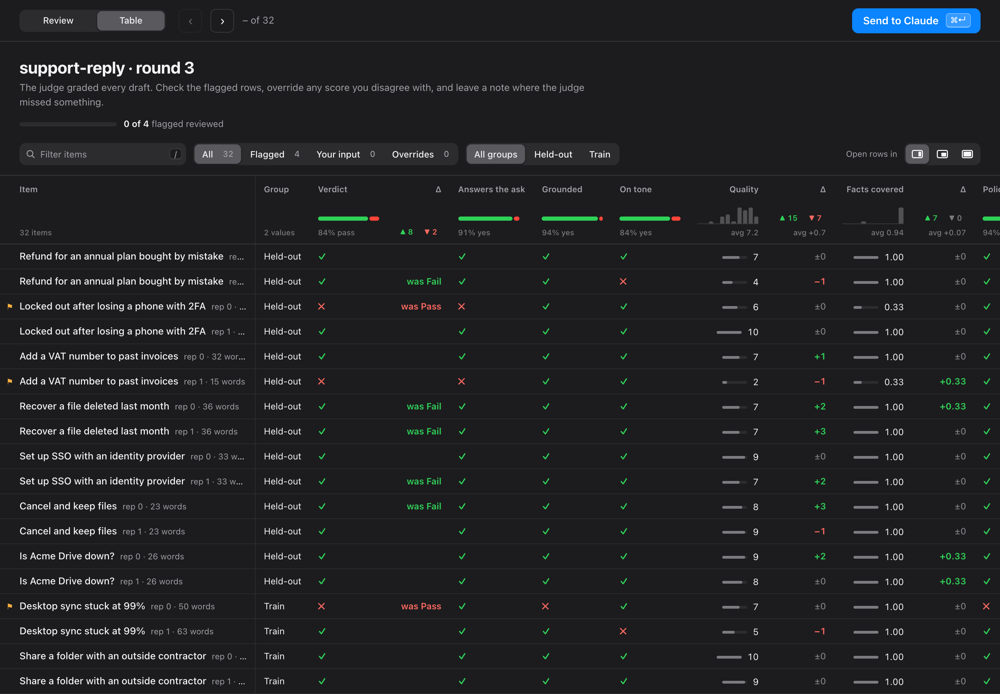

# evalkit

evalkit is a review page for work an agent did. The agent lists what it wants you to check, each with its own proposed answer. You go through them in the browser, mostly by keyboard, and change only what you disagree with. When you press ⌘↵ the agent gets back just your changes and carries on, and you can keep reviewing.

Use it to:

- **Approve before anything goes out:** a draft, code review comments, a deploy or a price change waits for your OK.
- **Correct a batch:** fix extracted fields, find the first wrong step in an agent's run, or rate two responses side by side.
- **Spot-check a judge:** see every row an LLM judge graded in one table, with the change from the last run, and open only the ones that look wrong.
- **Compare runs:** see the same eval across models, settings or weeks on one page.

The agent writes the review as YAML. evalkit is one static Go binary with the page built in (Preact + htm, no build step).

<table>
  <tr>
    <td width="50%" valign="top">
      <sub><b><a href="demos/01-status-updates">Status updates</a></b>: edit the draft against a length target, pick a verdict and flags, answer the agent's questions.</sub><br>
      <a href="docs/screenshots/status-updates.png"></a>
    </td>
    <td width="50%" valign="top">
      <sub><b><a href="demos/02-code-review">Code review</a></b>: triage each finding, then read the change as a split diff before anything posts.</sub><br>
      <a href="docs/screenshots/code-review.png"></a>
    </td>
  </tr>
  <tr>
    <td width="50%" valign="top">
      <sub><b><a href="demos/03-perf-canary">Perf canary</a></b>: metric tiles and canary-versus-fleet charts behind a promote, hold or roll back verdict.</sub><br>
      <a href="docs/screenshots/perf-canary.png"></a>
    </td>
    <td width="50%" valign="top">
      <sub><b><a href="demos/05-extraction">Invoice extraction</a></b>: mark a field wrong, type the fix, and precision and recall update as you go.</sub><br>
      <a href="docs/screenshots/extraction.png"></a>
    </td>
  </tr>
  <tr>
    <td width="50%" valign="top">
      <sub><b><a href="demos/08-judge-round">LLM judge round</a></b>: the table view: every row a judge graded, with a histogram and the change from the baseline in each header.</sub><br>
      <a href="docs/screenshots/judge-round.png"></a>
    </td>
    <td width="50%" valign="top">
      <sub><b><a href="demos/12-hill-climb">Hill climb</a></b>: the Runs view: six rounds of prompt changes on the same questions, and what each round fixed or broke.</sub><br>
      <a href="docs/screenshots/hill-climb.png"></a>
    </td>
  </tr>
</table>

```sh
go install github.com/jryio/evalkit/cmd/evalkit@latest   # or: make install, from a checkout

evalkit init           # ./suite.yaml, a starter to edit
evalkit serve          # review page at http://127.0.0.1:8790, opens the browser
evalkit wait           # (the agent) blocks until the human sends, prints what changed
evalkit skill --install   # teach Claude Code the loop: ~/.claude/skills/evalkit/SKILL.md
```

`evalkit help` lists every command; `evalkit help <command>` shows flags and examples. `make release` builds static binaries for macOS, Linux and Windows into `dist/`.

- **Schema:** [docs/schema.md](docs/schema.md) (also `evalkit docs`). How the demos shaped it: [docs/schema-changelog.md](docs/schema-changelog.md). Prior art: [docs/research/prior-art.md](docs/research/prior-art.md). Decisions: `adr list`.
- **Agent protocol:** [skill/SKILL.md](skill/SKILL.md).
- **Catalog:** `examples/kitchen-sink/suite.yaml` renders every artifact and question kind once.

## What the agent writes

Your agent writes a suite like this one, and `evalkit serve` turns it into the review page. Each item shows something to check and asks the same questions; `proposed` is the agent's own answer, which you keep or change.

```yaml
title: Release notes drafts
description: Approve each draft, or tell Claude what to change before it goes out.
questions:
  - id: verdict
    kind: choice
    label: Verdict
    primary: true
    options:
      - { value: ship, label: Ship it, tone: positive }
      - { value: fix, label: Needs work, tone: warning }
  - { id: note, kind: text, label: Note to Claude, key: n }
items:
  - id: v2-4
    title: Release notes for version 2.4
    show:
      - kind: markdown
        label: Draft
        text: Exports now finish in half the time, and failed uploads retry on their own.
    proposed:
      verdict: { value: ship, why: Both changes are in the changelog and the wording is plain. }
```

## Demos

| # | Demo | What it exercises |
|---|---|---|
| 1 | [Project status updates](demos/01-status-updates) | Editable text with a length meter, compare against gold, tone choices with proposals, flag chips, an action gate (post), agent questions, evidence list with per-row toggles |
| 2 | [Code review findings](demos/02-code-review) | Per-row choices on findings with proposed severities, links from a finding to its diff line, diff, test results |
| 3 | [Perf canary verdicts](demos/03-perf-canary) | Metric tiles and tables with deltas, time-series charts with marks, a proposed verdict, confidence scale, apply action |
| 4 | [Response preference](demos/04-pairwise) | Prompt and two responses side by side, A/B/tie/both-bad, a per-criterion rubric (per-row scales), LLM-judge calibration |
| 5 | [Invoice extraction](demos/05-extraction) | Document beside a table of fields, per-row correct/wrong/missing, a correction box that appears only when needed, live precision and recall |
| 6 | [Agent trajectories](demos/06-trajectories) | Transcript of tool calls, pick the first wrong step, failure taxonomy, a misleading auto-grader proposal |
| 7 | [Price recommendations](demos/07-price-changes) | Per-row approve and number inputs with model proposals, metrics and a bar chart, a staging action (synthetic numbers) |
| 8 | [LLM judge round](demos/08-judge-round) | The table view: a hill-climbing round's rows appended as JSONL, judge verdicts and 0–10 scores as proposals, measured values with baselines, flagged rows, Δ columns (`python3 build.py --trickle` streams rows in live) |
| 9 | [Model sweep](demos/09-model-sweep) | Runs: twelve model × effort configurations over the same cases and reps, two ordinal dimensions, a baseline run (what ships today), cost against pass rate with a dominated configuration |
| 10 | [Weekly samples](demos/10-weekly-samples) | Runs over time: six weekly runs of fresh production tickets with no pairing, a date dimension, a dip and recovery in the pass rate, run notes |
| 11 | [Judge change](demos/11-judge-change) | Two runs of the same drafts graded by an old and a new rubric, identical `show`, different proposals, flagged verdict flips; opens in the default view |
| 12 | [Hill climb](demos/12-hill-climb) | Six sequential rounds of an agent's instructions on the same questions, a round dimension, train and held-out groups, a round that overfits, regressions flagged, and a split diff of each query that changed (`python3 build.py`) |

Run one: `bin/evalkit serve demos/NN-*/suite.yaml`. Feedback lands in `feedback/` beside the suite (git-ignored).

### Coverage

Every question kind and artifact kind appears in the kitchen sink. Across the demos:

| Kind | Demos |
|---|---|
| choice, text | all |
| action | 1, 2, 3, 7 · multi 1, 6 · scale 3, 4 · toggle 1, 7 · number 7 · pick 6 |
| list | 1, 2, 3, 4 · table 1, 3, 5, 6, 7 · markdown 2–7 · json 5, 6 · metrics 3, 7 · chart 3, 7 |
| text 1 · diff 2 · tests 2 · transcript 6 · tally 5 | single-domain kinds: each matches one workflow's evidence |
| code, compare | 12 · kitchen sink |
| image | kitchen sink; it also carries the screenshots in the dogfood review suite |

## Layout

```
cmd/evalkit/        CLI: validate, serve, wait, summarize, done, schema
internal/suite/     load YAML, JSON Schema validation with line numbers, semantic checks
internal/feedback/  state, numbered snapshots, action results
internal/server/    HTTP API and static files
internal/summary/   diff of two snapshots, for agents
web/kit/core/       framework-free state, derivations, run statistics and keyboard model (node --test)
web/kit/ui/         layout: App, Sidebar, ItemView, ItemsTable, RunsView and its charts, micro charts, sheets
web/kit/controls/   one module per question kind
web/kit/renderers/  one module per artifact kind
web/styles/         tokens (light and dark) and component CSS
web/vendor/         Preact, htm, marked, Prism, uPlot, Observable Plot and @pierre/diffs (scripts/vendor-*.sh)
```

Adding a kind: write the module, register it in `web/kit/builtins.js`, add its branch to `internal/suite/suite.schema.json`, and add an item to the kitchen sink.

## Tests

`make test` runs `go vet`, `go test -race` and the Node tests. With a server running, `tests/e2e/smoke.sh <port>` opens every item and fails on render errors, and `tests/e2e/flow.sh <port>` does a keys-only review with two sends.
